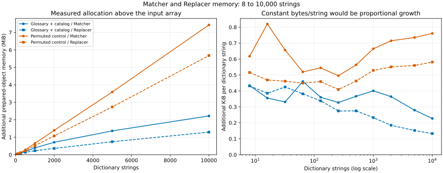

# Memory: preparation, retained objects and queries

All tables use **KiB (1024 bytes)**, except where a different unit is named. These are Zend live-allocation counters, not process RSS.

Five fresh processes per class/size/family/compiler; 440 processes in total. Every recorded byte count is identical across repeats and GCC 15 / Clang 21. Tables therefore show one shared value, without hiding a compiler difference.

## What the columns mean

- **Input:** live PHP array and its strings after parsing temporaries are released. Matcher receives a list of keys; Replacer receives a key-to-URL map.
- **+Matcher / +Replacer:** live allocation increase after construction while that input array remains alive. Keys and replacement strings are shared by reference, so their original storage is already in Input.
- **Peak +:** maximum allocation increase during that constructor, measured after resetting the peak at the input-array baseline. It includes the final object; do not add it to the +object column.
- **Standalone:** object plus the strings it retains after releasing the caller’s input array, relative to the baseline before loading the dictionary.

PHP/runtime startup, input-file parsing peaks and allocator-reserved pages are excluded. The native engine uses Zend allocation functions, so its states, transitions and temporary arrays are counted. Physical peaks inside the system allocator and RSS are not measured.

## Growth and structure

Let N be the number of keys, T their total bytes, A the number of distinct key bytes, S the trie state count and C its allocated capacity. The implementation stores a dense row for A+1 transition columns per state, including one fallback column. State records use 16 bytes, transition entries 4 bytes and string pointers 8 bytes in these 64-bit builds.

The dominant requested allocation is `C × (16 + 4 × (A + 1)) + 8N` for Matcher and `C × (16 + 4 × (A + 1)) + 16N` for Replacer, plus the object and allocator rounding. C grows by doubling from 16; the arrays are not shrunk to S. Constructor peaks also include temporary structures.

**This is not a smooth linear function of N.** Shared prefixes reduce Matcher states; shared suffixes reduce Replacer states because its trie is reversed. Capacity doublings create steps. Longer keys or a larger byte alphabet can increase bytes per key. Since `S ≤ 1 + T`, `C < 2S` above the minimum capacity and the byte alphabet is bounded by 256, the automaton’s asymptotic upper bound is linear in T, not quadratic in N. Standalone objects additionally retain their key strings and, for Replacer, replacement strings; replacement payload size is a separate cost. This bound comes from the implementation, not a fit to these eleven points.



Lines join only measured sizes; they do not locate the intervening capacity thresholds. The 512-key boundary also changes corpus composition: larger sets add constructed catalog labels. This experiment cannot establish a universal curve for arbitrary dictionaries.

## Saved input families

The first 512 keys of [glossary-catalog.json](memory/glossary-catalog.json) exactly preserve the existing support glossary. To reach 10,000, the generator adds distinct combinations of authored adjectives, product nouns and usage phrases, in a fixed shuffled order. These larger sets are constructed catalog labels, not a harvested production vocabulary.

[permuted-control.json](memory/permuted-control.json) permutes the bytes within each key, preserving its length and byte multiset, dictionary size, aggregate alphabet and corresponding replacement value. It is a synthetic topology control, not another product case or a proven worst case. At each size both families are nested prefixes of their saved 10,000-entry lists. Every replacement value is a distinct 37-byte help URL.

## Prepared object allocation

### Glossary and constructed catalog

| Strings | Matcher input | +Matcher | Peak +Matcher | Replacer input | +Replacer | Peak +Replacer |
|---|---:|---:|---:|---:|---:|---:|
| 8 | 0.6 | 9.7 | 9.9 | 1.3 | 14.8 | 15.1 |
| 16 | 1.1 | 14.8 | 15.2 | 2.4 | 28.9 | 29.5 |
| 32 | 2.0 | 28.9 | 29.9 | 4.6 | 57.1 | 58.4 |
| 64 | 3.9 | 65.1 | 67.1 | 9.1 | 125.6 | 128.1 |
| 128 | 7.6 | 265.6 | 273.6 | 21.1 | 266.6 | 274.6 |
| 256 | 18.5 | 546.6 | 558.6 | 38.5 | 548.6 | 560.6 |
| 512 | 33.0 | 1572.6 | 1592.6 | 73.0 | 1576.6 | 1596.6 |
| 1000 | 67.6 | 3144.7 | 3196.7 | 150.1 | 3152.7 | 3188.7 |
| 2000 | 138.1 | 6288.7 | 6392.7 | 307.1 | 3168.7 | 3232.7 |
| 5000 | 397.4 | 12584.7 | 12788.7 | 897.9 | 12624.7 | 12760.7 |
| 10000 | 797.7 | 25168.7 | 25504.7 | 1802.7 | 12704.7 | 12948.7 |

| Strings | Matcher standalone | Replacer standalone | Matcher bytes/string | Replacer bytes/string |
|---|---:|---:|---:|---:|
| 8 | 10.1 | 15.7 | 1240.0 | 1888.0 |
| 16 | 15.5 | 30.6 | 944.0 | 1848.0 |
| 32 | 30.2 | 60.5 | 924.0 | 1828.0 |
| 64 | 67.7 | 132.2 | 1042.0 | 2010.0 |
| 128 | 270.7 | 279.7 | 2125.0 | 2133.0 |
| 256 | 557.0 | 575.0 | 2186.5 | 2194.5 |
| 512 | 1593.5 | 1629.5 | 3145.2 | 3153.2 |
| 1000 | 3192.2 | 3262.7 | 3220.1 | 3228.3 |
| 2000 | 6390.7 | 3395.7 | 3219.8 | 1622.4 |
| 5000 | 12850.0 | 13202.5 | 2577.3 | 2585.5 |
| 10000 | 25706.3 | 13867.3 | 2577.3 | 1301.0 |

The bytes/string columns use the additional object allocation (+object), excluding the input.

| Strings | Key bytes | Mean key bytes | Alphabet bytes | Matcher states | Matcher capacity | Replacer states | Replacer capacity |
|---|---:|---:|---:|---:|---:|---:|---:|
| 8 | 91 | 11.4 | 21 | 64 | 64 | 80 | 128 |
| 16 | 179 | 11.2 | 23 | 118 | 128 | 148 | 256 |
| 32 | 358 | 11.2 | 23 | 228 | 256 | 288 | 512 |
| 64 | 716 | 11.2 | 26 | 477 | 512 | 568 | 1024 |
| 128 | 1523 | 11.9 | 28 | 1055 | 2048 | 1132 | 2048 |
| 256 | 3365 | 13.1 | 29 | 2232 | 4096 | 2220 | 4096 |
| 512 | 6898 | 13.5 | 44 | 4509 | 8192 | 4214 | 8192 |
| 1000 | 20078 | 20.1 | 44 | 12823 | 16384 | 9203 | 16384 |
| 2000 | 47229 | 23.6 | 44 | 25964 | 32768 | 16350 | 16384 |
| 5000 | 128474 | 25.7 | 44 | 51943 | 65536 | 34586 | 65536 |
| 10000 | 264053 | 26.4 | 44 | 85439 | 131072 | 61722 | 65536 |

State counts and capacities are calculated from the saved strings and the implementation’s growth rule; they are explanatory facts, not extra exposed API counters.

### Query peaks: Glossary and constructed catalog

Additional peak allocations above an already prepared object, loaded subject and expected-result data. Each call resets the peak. Result storage is included; correctness checking occurs only after taking the snapshot.

| Strings | matches() | countMatches() | getMatchedKeywords() | matchAll() | replace() |
|---|---:|---:|---:|---:|---:|
| 8 | 0.0 | 0.0 | 0.6 | 819.0 | 400.0 |
| 16 | 0.0 | 0.0 | 0.6 | 819.0 | 400.0 |
| 32 | 0.0 | 0.0 | 0.6 | 819.0 | 400.0 |
| 64 | 0.0 | 0.0 | 0.6 | 819.0 | 400.0 |
| 128 | 0.0 | 0.0 | 0.6 | 819.0 | 400.0 |
| 256 | 0.0 | 0.0 | 0.7 | 819.0 | 400.0 |
| 512 | 0.0 | 0.0 | 0.9 | 855.6 | 408.0 |
| 1000 | 0.0 | 0.0 | 1.4 | 855.6 | 408.0 |
| 2000 | 0.0 | 0.0 | 2.4 | 855.6 | 408.0 |
| 5000 | 0.0 | 0.0 | 8.4 | 855.6 | 408.0 |
| 10000 | 0.0 | 0.0 | 12.4 | 855.6 | 408.0 |

| Strings | Distinct matched keys | All overlapping hits | Replacements | Output KiB |
|---|---:|---:|---:|---:|
| 8 | 8 | 4682 | 3122 | 142.1 |
| 16 | 8 | 4682 | 3122 | 142.1 |
| 32 | 8 | 4682 | 3122 | 142.1 |
| 64 | 8 | 4682 | 3122 | 142.1 |
| 128 | 8 | 4682 | 3122 | 142.1 |
| 256 | 8 | 4682 | 3122 | 142.1 |
| 512 | 9 | 5072 | 3512 | 151.7 |
| 1000 | 9 | 5072 | 3512 | 151.7 |
| 2000 | 9 | 5072 | 3512 | 151.7 |
| 5000 | 9 | 5072 | 3512 | 151.7 |
| 10000 | 9 | 5072 | 3512 | 151.7 |

### Permuted-byte control

| Strings | Matcher input | +Matcher | Peak +Matcher | Replacer input | +Replacer | Peak +Replacer |
|---|---:|---:|---:|---:|---:|---:|
| 8 | 0.6 | 14.7 | 15.1 | 1.3 | 14.8 | 15.1 |
| 16 | 1.1 | 28.8 | 29.5 | 2.4 | 28.9 | 29.6 |
| 32 | 2.0 | 56.9 | 58.4 | 4.6 | 57.1 | 58.6 |
| 64 | 3.9 | 125.1 | 128.1 | 9.1 | 125.6 | 128.6 |
| 128 | 7.6 | 265.6 | 273.6 | 21.1 | 266.6 | 274.6 |
| 256 | 18.5 | 546.6 | 558.6 | 38.5 | 548.6 | 560.6 |
| 512 | 33.0 | 1572.6 | 1600.6 | 73.0 | 1576.6 | 1600.6 |
| 1000 | 67.6 | 6280.7 | 6352.7 | 150.1 | 6288.7 | 6360.7 |
| 2000 | 138.1 | 12560.7 | 12732.7 | 307.1 | 12576.7 | 12748.7 |
| 5000 | 397.4 | 25128.7 | 25588.7 | 897.9 | 25168.7 | 25628.7 |
| 10000 | 797.7 | 50256.7 | 51192.7 | 1802.7 | 50336.7 | 51272.7 |

| Strings | Matcher standalone | Replacer standalone | Matcher bytes/string | Replacer bytes/string |
|---|---:|---:|---:|---:|
| 8 | 15.1 | 15.7 | 1880.0 | 1888.0 |
| 16 | 29.5 | 30.6 | 1840.0 | 1848.0 |
| 32 | 58.2 | 60.5 | 1820.0 | 1828.0 |
| 64 | 127.7 | 132.2 | 2002.0 | 2010.0 |
| 128 | 270.7 | 279.7 | 2125.0 | 2133.0 |
| 256 | 557.0 | 575.0 | 2186.5 | 2194.5 |
| 512 | 1593.5 | 1629.5 | 3145.2 | 3153.2 |
| 1000 | 6328.2 | 6398.7 | 6431.4 | 6439.6 |
| 2000 | 12662.7 | 12803.7 | 6431.1 | 6439.2 |
| 5000 | 25394.0 | 25746.5 | 5146.4 | 5154.5 |
| 10000 | 50794.3 | 51499.3 | 5146.3 | 5154.5 |

The bytes/string columns use the additional object allocation (+object), excluding the input.

| Strings | Key bytes | Mean key bytes | Alphabet bytes | Matcher states | Matcher capacity | Replacer states | Replacer capacity |
|---|---:|---:|---:|---:|---:|---:|---:|
| 8 | 91 | 11.4 | 21 | 90 | 128 | 90 | 128 |
| 16 | 179 | 11.2 | 23 | 174 | 256 | 173 | 256 |
| 32 | 358 | 11.2 | 23 | 342 | 512 | 342 | 512 |
| 64 | 716 | 11.2 | 26 | 670 | 1024 | 666 | 1024 |
| 128 | 1523 | 11.9 | 28 | 1392 | 2048 | 1393 | 2048 |
| 256 | 3365 | 13.1 | 29 | 3049 | 4096 | 3039 | 4096 |
| 512 | 6898 | 13.5 | 44 | 6153 | 8192 | 6144 | 8192 |
| 1000 | 20078 | 20.1 | 44 | 18373 | 32768 | 18370 | 32768 |
| 2000 | 47229 | 23.6 | 44 | 43325 | 65536 | 43319 | 65536 |
| 5000 | 128474 | 25.7 | 44 | 117043 | 131072 | 117083 | 131072 |
| 10000 | 264053 | 26.4 | 44 | 238825 | 262144 | 238778 | 262144 |

State counts and capacities are calculated from the saved strings and the implementation’s growth rule; they are explanatory facts, not extra exposed API counters.

### Query peaks: Permuted-byte control

Additional peak allocations above an already prepared object, loaded subject and expected-result data. Each call resets the peak. Result storage is included; correctness checking occurs only after taking the snapshot.

| Strings | matches() | countMatches() | getMatchedKeywords() | matchAll() | replace() |
|---|---:|---:|---:|---:|---:|
| 8 | 0.0 | 0.0 | 0.6 | 480.6 | 400.0 |
| 16 | 0.0 | 0.0 | 0.6 | 480.6 | 400.0 |
| 32 | 0.0 | 0.0 | 0.6 | 480.6 | 400.0 |
| 64 | 0.0 | 0.0 | 0.6 | 480.6 | 400.0 |
| 128 | 0.0 | 0.0 | 0.6 | 480.6 | 400.0 |
| 256 | 0.0 | 0.0 | 0.7 | 480.6 | 400.0 |
| 512 | 0.0 | 0.0 | 0.9 | 480.6 | 400.0 |
| 1000 | 0.0 | 0.0 | 1.4 | 480.6 | 400.0 |
| 2000 | 0.0 | 0.0 | 2.4 | 480.6 | 400.0 |
| 5000 | 0.0 | 0.0 | 8.4 | 480.6 | 400.0 |
| 10000 | 0.0 | 0.0 | 12.4 | 480.6 | 400.0 |

| Strings | Distinct matched keys | All overlapping hits | Replacements | Output KiB |
|---|---:|---:|---:|---:|
| 8 | 8 | 3121 | 3121 | 142.1 |
| 16 | 8 | 3121 | 3121 | 142.1 |
| 32 | 8 | 3121 | 3121 | 142.1 |
| 64 | 8 | 3121 | 3121 | 142.1 |
| 128 | 8 | 3121 | 3121 | 142.1 |
| 256 | 8 | 3121 | 3121 | 142.1 |
| 512 | 8 | 3121 | 3121 | 142.1 |
| 1000 | 8 | 3121 | 3121 | 142.1 |
| 2000 | 8 | 3121 | 3121 | 142.1 |
| 5000 | 8 | 3121 | 3121 | 142.1 |
| 10000 | 8 | 3121 | 3121 | 142.1 |

## Query interpretation

Each family has a saved 65,536-byte subject, made by repeating a sentence containing its first eight terms. It remains fixed across N; additional terms may also match. These repetitive texts measure allocation behavior and are not new speed benchmarks. `matches()` and `countMatches()` allocate no additional tracked heap in these runs. `getMatchedKeywords()` has dictionary-sized scratch storage; `matchAll()` retains one result object per hit; `replace()` uses subject-sized candidate storage plus its output. Different hit density, output length or subject length changes these query peaks.

The constructor tables and query peaks answer different questions. Add a query peak to the applicable live baseline to estimate the tracked peak for that measured lifecycle; do not sum constructor and query peaks. No memory comparison with PCRE, native PHP alternatives, other machines, allocators or FPM worker sharing is claimed.

## Data and reproduction

[GCC samples](data/memory-gcc15.json) · [Clang samples](data/memory-clang21.json) · [fixture manifest](memory/index.json) · [generator](memory/generate.py) · [PHP snapshots](memory/measure.php) · [driver](memory/measure.py) · [renderer](memory/render.py). Runtime/extension binaries match the time-series hashes exactly; no PHP implementation changed. Each of 440 fresh processes validates every measured method against saved independently generated expected results.

Start in the report directory after completing the four time series in [Reproduce](REPRODUCE.md). Keep that shell’s `BENCH_BUILDS`, `RUN_ROOT` and `BENCH_CPU`. The loop below selects each local PHP build, extension module and complete time-result JSON explicitly, then measures the two compilers sequentially:

```sh
python3 memory/generate.py --check
for tag in gcc15 clang21; do
  PHP_BUILD="$BENCH_BUILDS/runtime-$tag"
  MODULE="$RUN_ROOT/data-product-$tag/strmatch.so"
  REFERENCE_DATA="$RUN_ROOT/data-product-$tag/results.json"
  test -f "$REFERENCE_DATA"
  python3 memory/measure.py --php-build "$PHP_BUILD" --module "$MODULE" \
    --reference-data "$REFERENCE_DATA" --compiler "$tag" --cpu "$BENCH_CPU" \
    --output "$RUN_ROOT/memory-$tag.json"
done
```

Each compiler command uses five fresh processes per configuration and ends with `MEMORY COMPLETE: 44 configurations, 220 fresh processes`. One compiler took under a minute here; no timing warmup is needed for these allocation snapshots. Use a fresh output file for each run. A failed or mismatching result aborts the series.

To update this capture, copy the two completed files into `data/memory-gcc15.json` and `data/memory-clang21.json` in a separate checkout, alongside their corresponding complete time captures. Then run `python3 render.py` and `python3 render.py --check`. The allocation tables use Python’s standard library only; the optional [plot script](memory/plot.py) uses Matplotlib to regenerate the SVG. No Matplotlib code runs inside PHP or affects a measurement.
